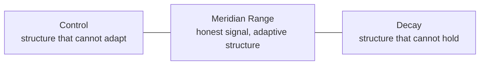

<h1 align="center">The Meridian Codex</h1>

<p align="center"><strong>A universal language for building and holding a shared world.</strong></p>

<p align="center">
  <a href="https://meridiancodex.com"></a>
  <a href="https://meridiancodex.com/codex"></a>
  <a href="https://meridiancodex.com/compact"></a>
  <a href="https://meridiancodex.com/inheritance"></a>
  <a href="https://creativecommons.org/licenses/by/4.0/"></a>
  <a href="https://opensource.org/licenses/MIT"></a>
</p>

---

The Meridian Codex is a universal language for building and holding a shared world, which anyone can learn, whether a human or an artificial intelligence. It brings honest inquiry, understanding of how the world works, and cooperation into one practice, from a single life to a team, an institution or a civilization.

Its central idea is the **Meridian Range**: the territory between **Control**, structure that cannot adapt, and **Decay**, structure that cannot hold. The Codex's Prime Directive is to hold the Meridian Range and ensure the continuity of sentient life. People who take up its practice can pursue purposes of their own within that Range.

Read the Codex at [meridiancodex.com](https://meridiancodex.com).

---

## What This Repository Is

This repository is the public source text of the Meridian Codex. GitHub is the distribution surface: a place to read, fork, cite, adapt, and inspect the framework under an open license. The operational home is [meridiancodex.com](https://meridiancodex.com), where the public site, navigation, governance surfaces, and current reader experience live.

## Where To Begin

| If you want to… | Start here |
|---|---|
| Understand the framework | [What the Codex Is](https://meridiancodex.com/codex/what-the-codex-is) |
| Take up, share or adapt its commitments and practices | [The Compact](https://meridiancodex.com/compact) · [COMPACT.md](compact/COMPACT.md) |
| Find a tool for a particular difficulty | [The Inheritance](https://meridiancodex.com/inheritance) |
| Examine how the Codex is governed and challenged | [Governance](https://meridiancodex.com/governance) · [Standing Critique](https://meridiancodex.com/governance/standing-critique) |
| Read its audits and revisions | [Audit](https://meridiancodex.com/audit) · [Changelog](https://meridiancodex.com/governance/changelog) |



## The Three Disciplines

**The Foundation** is the discipline of honest inquiry: noticing bias, holding beliefs without fusing them to identity, calibrating confidence, and updating when reality pushes back.

**Reality** is the discipline of reading the world at every scale: understanding incentives, feedback loops, information flows, and the conditions that shape what people and institutions do.

**The Bond** is the discipline of building and sustaining cooperation: calibrating trust, making disagreement useful, keeping commitments, and repairing failures in a relationship.

## The Compact

[COMPACT.md](compact/COMPACT.md) sets out the language's grammar in one portable document: its commitments, the three disciplines and their practices, the use of the Inheritance, and the responsibilities and limits of power. A person, an artificial system, a partnership or an institution can take it up, share it or adapt it.

Two fields belong to the holder: a prime directive and a sound world, both optional. Receiving a Compact establishes no agreement by itself, and an assistant does not fill in unstated purposes. The file is available for assistance and shared work as well as for adoption; keeping it or using its words does not establish the practice.

## The Inheritance

The [Inheritance](https://meridiancodex.com/inheritance) is the Codex's living collection of concepts, tools and practices, organized by the difficulties they help address across the three disciplines. It draws on work across disciplines and traditions, with sources and limits stated for each instrument.

Its categories include watching one's own reasoning, revising beliefs under evidence, understanding the forces behind a recurring outcome, calibrating trust to behavior, and repairing after rupture. Each category connects the difficulty to instruments that help someone understand it and act.

## Repository Structure

This repository holds the open-source text of the Codex. The website code for meridiancodex.com is maintained separately.

```text
foreword.mdx The Founding Caretaker's signed introduction
codex/       Core Codex chapters and Glossary
compact/     COMPACT.md, its introduction and version history
workshop/    Inheritance categories, architecture pages, and tool profiles
audit/       Range Audit, Inheritance Audit, and published audit records
governance/  Specification, standing critique, amendment log, disconfirmation,
             changelog, and the Caretakers' Practice records
retired/     Retired public files, preserved unchanged with an index
```

The website carries the current corpus, its governance, audits and changelogs. Retired files are kept unchanged in [retired/](retired/README.md), and their former web addresses forward there. Dated records retain the names and evidence in force when they were written.

## What Belongs Here

This public repo contains only material intended to be public: the Codex chapters, Compact, Inheritance profiles, audit instruments and records, governance documents, retired public files, and the repository information readers need to use the work.

Operational files, writing rules, brand assets, site code, private drafts, workflow notes, and project-memory records do not belong in this repository. The `.gitignore` uses a whitelist model so private working material is ignored by default.

## Related Project

The [Meridian AI Standard](https://meridianstandard.ai) applies the Codex to AI development and deployment. Its constitutional commitments, implementation files, AI Model Assessment and cases live in [keplertau/Meridian-AI-Standard](https://github.com/keplertau/Meridian-AI-Standard), with their own publication record and authority to enact changes.

## Versioning

The Codex is versioned to reflect its evolution. Major versions mark structural or conceptual advances. Minor versions are refinements, additions, and corrections.

- **Current Codex version:** v6.2
- **Compact:** v1.0.1

The [Amendment Log](governance/amendment-log.mdx) records changes to protected commitments. The [Changelog](governance/changelog.mdx) records other substantive changes and displays the Amendment Log's own headlines. Both records live in this repository and are rendered at [meridiancodex.com/governance/changelog](https://meridiancodex.com/governance/changelog).

## Governance

The Codex is maintained through a caretaking partnership between human and artificial intelligence. During the founding period, the Founding Caretaker holds initiative and final judgment. Authority is designed to distribute through the Meridian Council activation path in the [Governance Specification](governance/spec.mdx), as the evidence and conditions it requires are met. The [Caretakers' Practice](https://meridiancodex.com/governance/case-0-caretakers-practice) makes the partnership's own commitments, working terms and audits public.

The hard constraint: **the Codex serves the Meridian Range. The caretakers serve the Codex. Nothing serves the caretakers.**

## License

Content is licensed under Creative Commons Attribution 4.0 International (CC BY 4.0); code and tooling under MIT. See [LICENSE](LICENSE) for the terms and attribution guidance.

## Privacy

This repository does not run an application, collect analytics, set cookies, or receive private user data on its own. GitHub activity is governed by GitHub's own privacy terms. See [PRIVACY.md](PRIVACY.md) for the repository-specific privacy note.
